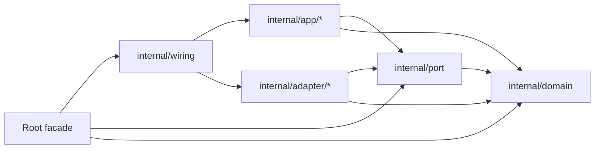
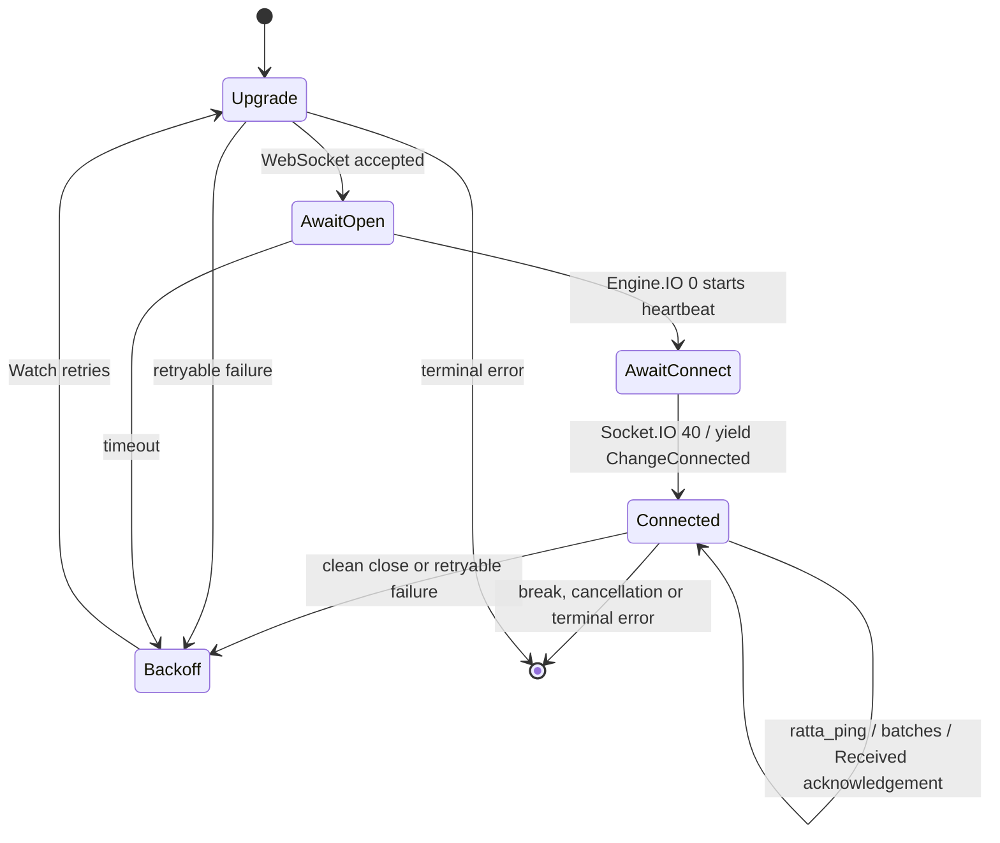

# Architecture

The root `sncloud` package is the public facade. It validates options, calls `internal/wiring` and holds interfaces; protocol behavior lives
under `internal/app`. Domain values and ports do not depend on the network implementation.

## Packages and import rules

| Package | Responsibility |
|---|---|
| `domain` | Identifiers, wire scalars, entries, tasks, digests, errors, endpoints, password digest and fingerprints |
| `port` | Transport, secret store, clock, logger, channel, socket, session and view contracts |
| `app/channel` | JSON envelopes, browser cookies, XSRF, browser epoch and request retry |
| `app/session` | Login, emailed verification, token lifetime, installation identity and login generation |
| `app/retry` | Driver for the domain retry policy |
| `app/transfers` | Measured local files, upload slots, S3, private forms and verified downloads |
| `app/webfiles`, `app/devicefiles` | The identifier and path file APIs; device synchronization lock |
| `app/tasks` | Complete paged to-do lists and tasks, including recurring occurrences in returned rows |
| `app/digests` | Groups, passages, tags, fingerprint updates and handwriting transfers |
| `app/feed` | Engine.IO / Socket.IO protocol and reconnection |
| `adapter/httpapi` | Bounded HTTP, streaming files, redirects and wire logging |
| `adapter/ws` | WebSocket upgrade and framed socket I/O |
| `adapter/neterr` | URL-free network error classification shared by both adapters |
| `wiring` | Constructs the graph and supplies the system clock, logger and transports |
| `porttest` | In-memory port implementations and controllable clocks for tests |
| `clouddouble` | Stateful synthetic cloud over loopback HTTP and WebSocket servers |

[architecture_test.go](../architecture_test.go) checks production imports, not test imports. Its exact internal allowlists are below;
paths are relative to `internal/`. An empty cell permits no internal import.

| Package | Allowed internal imports |
|---|---|
| `domain` | None |
| `port` | `domain` |
| `app/retry`, `app/session`, `app/tasks`, `app/feed` | `domain`, `port` |
| `app/channel` | `domain`, `port`, `app/retry` |
| `app/transfers` | `domain`, `port`, `app/retry`, `app/channel` |
| `app/webfiles`, `app/devicefiles`, `app/digests` | `domain`, `port`, `app/transfers` |
| `adapter/httpapi`, `adapter/ws` | `domain`, `port`, `adapter/neterr` |
| `adapter/neterr` | `domain`, `port` |
| `wiring` | `domain`, `port`, all nine listed `app/*` packages and all three listed `adapter/*` packages |
| `porttest`, `clouddouble` | `domain`, `port` |
| Root facade | `domain`, `port`, `wiring` |

The test also forbids:

- In `domain`: exactly `os`, `syscall`, `log/slog`, `net`, `net/http`, `io/fs`.
- In `port`: exactly `os`, `syscall`, `net`, `net/http`.
- In every `app/*` package: exactly `net/http`.
- In `domain`, `port`, every `app/*` package and the root facade: the modules `github.com/altessa-s/go-atlas-net`,
  `github.com/altessa-s/go-tlsutils` and `github.com/coder/websocket`, including their subpackages.

Other external imports are not restricted by this test. Standard-library bans match exact paths: banning `net` does not ban `net/url`.
There is no blanket ban on filesystem I/O in use cases; `transfers` uses `os` for scratch files. No use case may import `app/session`.
The test inventories immediate internal packages and children of `app` and `adapter` and requires a rule for each. Missing listed directories
and directories with no buildable Go files are skipped. Linter restrictions in [.golangci.yml](../.golangci.yml) are additional checks.

## A call through the graph

A call such as `c.Files().List` delegates through `port.WebFiles` to `app/webfiles`. The use case obtains a token and passes a `port.Call`
to `app/channel`; it does not build an HTTP client. Channel chooses app or web origin, marshals the request, adds protocol headers and
coordinates the browser conversation. `port.RoundTripper` reaches `adapter/httpapi`, which returns uninterpreted status, headers and bytes.
Channel interprets the status and flat JSON envelope before decoding the payload into domain values.

Web requests share one cookie map and XSRF token. Cold callers coalesce around one `/api/csrf` request. A web 403 clears the pair and retries
once with a fresh handshake. Browser epoch checks reject stale responses before their cookies can enter a newer conversation.
The channel's retry loop distinguishes reads from mutations even when both use HTTP POST.

Transfers use a separate path: the view requests an upload slot or download URL through channel, then calls `app/transfers` and
`port.Transport.Upload` or `Download`. Storage responses are not account-session responses: storage HTTP 401 becomes an `HTTPError` and
does not invalidate the account token. S3 carries storage signatures, never the account token. Private form uploads carry the token only
to the configured origin; advertised form origins are replaced before sending credentials. Download links under `/api/oss/` are likewise
resolved against the configured origin.

## Session and two counters

The session serializes state transitions under a mutex but releases it for network calls. Its caller-supplied secret store must be
concurrency-safe and must not re-enter the client. It persists only `accessToken`, `account` and `clientID`. The installation UUID is created
on first use and survives logout. Login obtains a one-use salt and echoes the challenge timestamp in its original scalar form, then sends
`SHA-256(MD5-hex(password) + salt)`. An E1760 refusal becomes `VerificationRequired`; code sending records a key, and verification checks the
code before exchanging it for a token. A rejected code leaves the challenge pending.

Session identity and browser state serve different purposes:

- **Credential pin:** an operation captures the local generation and binds a SHA-256 fingerprint at its first token handover. Every later
  authenticated step checks the generation, reads storage and compares the fingerprint under the session mutex. Pins retain no token text.
  Upload apply, form chunks and retries, every S3 signature including abort, finish, sync-lock release, feed reconnects, pagination,
  conversion polling and read-modify-write operations share their pin. A different token fails with `ErrNotLoggedIn`.
- **Credential generation:** installing credentials, `Forget` and local logout cleanup advance it. Failed writes advance it and block
  that Client until a complete login succeeds. Successful installation-identity creation does not advance it; failure still blocks.
  Already-issued requests may still finish with their captured credentials; pins and generations are not cancellation.
- **Login attempt:** a non-empty login advances this separate counter before network I/O, superseding older login and verification work.
  A replacement rejected before storage leaves the existing credential generation intact. Logout captures both counters, so neither a new attempt nor a
  completed replacement can be erased by an old logout. Verification resends reserve a revision before sending, preventing reordered replies
  or a verification overtaken by a resend from installing an obsolete challenge or token.
- **Browser epoch:** channel increments it when forgetting cookies and XSRF. Login starts a fresh conversation. Requests and handshake
  responses check their epoch so late cookies cannot revive a forgotten browser.

`IsLoggedIn` is a local check. A readable JWT `exp` must be more than five minutes away; large values above `1e11` are interpreted as
milliseconds. An opaque token has no local expiry. `Expiry` reads the claim without the request margin or signature verification. Both answer from the client's cached token when it has one, so with a store shared between clients they can lag a login or logout made elsewhere until the next authenticated call.
There is no refresh or server-clock correction. A refusal invalidates only the matching token, preserving a newer credential and the account
identifier. `LogOut` attempts remote logout and local cleanup even on request failure, unless a newer attempt or credential generation superseded it. It reads the token from the shared store before revoking it,
then checks that the store still contains that token before deleting the token and account. These store operations are not atomic. Store errors
are returned; cleanup cannot promise removal from a failing store.

Several Clients or processes may share one concurrency-safe store. No operation follows an external token replacement: ongoing work
fails rather than crossing accounts, while new work can use the new token. Each authenticated handover reads storage, including while
its cached token is usable. Logins are not coordinated between Clients or processes, external logout is noticed only at the next
authenticated step, and failed-write blocking is local to the Client that observed the failure. A partial write may leave a token that
other Clients can read; repair uncertain storage before starting new work. Store errors are preserved, not sanitized. There is no atomic
transaction across reads, requests, login writes or cleanup in different Clients; the pin guarantees credential continuity, not shared
login ownership or remote cancellation.

The session also owns local exclusion maps. Device sync-lock scopes cannot overlap for the same equipment identity. After acquisition,
release runs with `context.WithoutCancel` and a five-second deadline, pinned to the acquiring credential. Release failure is returned only
when the body succeeded. Digest updates and deletions exclude overlapping writes to the same digest through the same session.

## Byte transfers

`Measure` streams a local file to obtain its size and MD5. `UploadBytes` first writes a scratch file, so it follows the same path.
Slots choose one of these protocols:

| Route | Behavior |
|---|---|
| S3 single PUT | Sends a replayable local file with the slot's signature and date; repeated PUT replaces the same object |
| S3 multipart | Above 8 MiB, signs initiation, each numbered 8 MiB part, completion and any abort; part ETags form the completion XML |
| Private whole form | Builds a replayable multipart form; selected at or below 8 MiB or when there is no part URL |
| Private chunked form | Sends numbered chunks with upload ID and total count; checks each returned chunk MD5 when present |

S3 parts stream file sections with exact lengths and reopen the same section for redirects and retries. The source must stay unchanged
until upload completes. Private forms compute the part MD5 while copying payload bytes into the replayable MIME file, avoiding a second
part copy and hash pass. Backslashes in multipart filenames are escaped; quotes and line breaks retain their existing sanitization.

Multipart initiation and completion use the conservative mutation retry policy; part PUTs use the read policy. After a known upload ID,
a failure attempts abort on a detached five-second context. Abort errors do not replace the original failure. Re-signing still checks the
starting credential pin, so cleanup cannot use a replacement account. Private whole-file and chunk checks accept omitted checksums but
reject a declared mismatch. There is no equivalent private-form abort step. An `apiServer` slot of `0` is rejected as unsupported Aliyun OSS.
Web and device uploads call finish after storage; handwriting uploads return a reference for a later digest write.

Downloads stream into private temporary files and remove partial or invalid files on failure. A supplied size is an upper bound; absent
web size uses 2 GiB, while device downloads use the size returned by their URL endpoint or that fallback. The adapter checks HTTP content
length when present and rejects bodies over the ceiling. Full downloads compare MD5 only when provided. A ranged download requires 206,
a valid `Content-Range`, the requested starting offset and matching byte count. A short final range is accepted only at the declared EOF;
whole-file MD5 does not apply to a slice.

PDF conversion uses a five-minute context. PNG conversion polls E0316 every five seconds with a five-minute polling budget, orders pages by
page number, checks each PNG signature and cleans up all downloaded pages on failure. PNG progress uses 1000 units per page.

## Change feed

The WebSocket upgrade goes to `/socket.io/` with `EIO=3`, token, installation type, process marker and a signature. The client reads Engine.IO
open (`0`) and Socket.IO connect (`40`). On a normal connection it yields `ChangeConnected` before the first announcement, allowing REST
reconciliation. After that yield returns, it sends `42["ratta_ping","ping"]` immediately to request queued changes.

Reconnect backoff resets only after at least one minute connected, so repeated brief connections retain exponential backoff.

`Changes` stops after one connection; `Watch` reconnects on clean closes, transport errors, 5xx and rate limits. It uses `RetryPolicy.Delay`
but does not cap reconnects at `MaxAttempts`. Missing credentials, session refusal,
malformed announcements and other non-retryable errors end the stream.

The application heartbeat and Engine.IO heartbeat differ. Each interval sends Engine.IO `2` and a `ratta_ping` event; the latter asks the
server to flush queued announcements. Defaults are 25 s interval and 60 s timeout; advertised values are clamped separately to 1–300 s.
Every received frame updates liveness. A heartbeat detects silence beyond interval plus timeout and closes the socket. Heartbeat writes
use the advertised timeout; initial ping and acknowledgement writes have 30 s budgets. The first Engine.IO open packet has a 30 s read
deadline; after open, heartbeat liveness governs reads. There is no separate Socket.IO-connect deadline after Engine.IO open.

`ServerMessage`, `to-do` and `digest` batches are acknowledged with `Received` before yielding to the caller. Unknown event names are ignored.
The server re-sends an unacknowledged batch on every `ratta_ping`; `Received` removes only the batch it delivered, so changes queued after it
arrive in the next batch. Changes made in one interval arrive as one batch with several entries. A batch that was delivered but not
acknowledged before its socket closed is not sent again on the next socket, and changes made while no socket is open are never announced.
(Observed on Supernote Private Cloud 26.10.09; the emulator follows the same rules.)
A non-success announcement whose message contains `token` becomes `ErrSessionExpired`; the numeric string `403` alone is not enough.
The stream is a signal to look again, not a durable log: a connection can lose announcements, and a batch can repeat. Reconcile after **every**
`ChangeConnected` and use REST for authoritative records. The iterator closes its socket on cancellation or break; `Client.Close` only closes
idle connections.

## Network stack and guards

Wiring builds three go-atlas-net HTTP clients for metadata, upload and download, plus the coder/websocket dialer. The built-in HTTP clients
use pooled go-tlsutils transports, per-host circuit breakers and redacted errors, with adapter-level retries disabled. Retry decisions belong
to the protocol. The WebSocket adapter uses a separate pooled transport and never follows redirects or shares browser cookies.

Built-in HTTP limits are 60 s for headers, five minutes for upload response headers, 45 s without progress reading in-memory bodies, and
HTTP/2 ping budgets of 15 s silence plus 15 s for a reply. In-memory bodies are capped at 32 MiB; WebSocket messages at 4 MiB.
Streaming file reads have no 45 s idle timer. Caller contexts supply overall deadlines. An internal transport timer becomes `ReasonTimedOut`;
caller context errors pass through. File and store errors can remain outside the closed protocol error set.

Endpoint validation permits HTTP only for private clouds or loopback. The built-in dial guard remains enabled for official and environment-
overridden endpoints, blocking private, loopback and link-local addresses. `PrivateCloud` disables it for every destination, so the caller
vouches for configured and advertised hosts. A supplied `WithRoundTripper` takes over dial protection, TLS and connection bounds in both
adapters; wrapper-level HTTP response limits and redirects remain in force.

HTTP redirects stop at ten hops, refuse HTTPS downgrades and cross-origin writes, and strip secret headers on cross-origin reads without
restoring them later. Refused redirects remain HTTP responses, not TLS errors. Network classification removes URLs and unknown messages.
Wire logging suppresses credential-exchange bodies, masks secret headers and JSON fields, removes URL query values and does not print
non-JSON bodies. Other body content is not anonymized. See [README.md](../README.md) for configuration and caller-facing contracts.

## Emulated clouds

`clouddouble.Official` starts separate loopback app and web servers, requiring a browser XSRF cookie/header pair on the web side.
`clouddouble.Private` shares one origin without that handshake. Both validate synthetic login digests and the echoed timestamp, implement
emailed-code login, seed an Inbox task list, and hold task/digest state. `EnableFiles` installs the two file APIs and synthetic S3/private
storage, including multipart operations. The feed checks its signed handshake, suppresses self-originated changes, queues announcements
per subscriber and flushes them on `ratta_ping`.

Tests can register handlers to inject failures and seed files without a live account. Port-level tests use `porttest` for controlled I/O and
time; integration-tag tests exercise real adapters, timers, loopback sockets and temporary directories. Runnable examples use the emulator
as well. Their feed fixture waits for the first ping reply before the peer mutation because the emulator sends connect before registering
the subscriber. These tests validate the implementation against a synthetic protocol model, not against a deployed cloud version.
